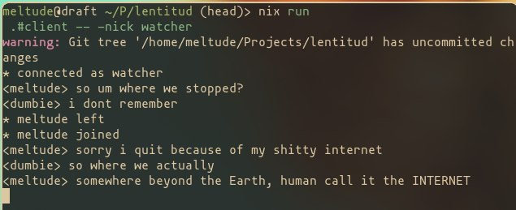

# _lentitud_

A small WebSocket chat server, written in Go:



The name of this project originally comes from a reference to Chris Christodoulou's track "...con lentitud poderosa" from the Risk of Rain 2 Official Soundtrack (OST).

## Features

- Broadcast chat over WebSocket.
- JSON protocol with server-assigned nicknames and timestamps.
- Unique exact-match nicknames, released when a user disconnects.
- Ping/pong keepalive, read limits, rate limiting, and slow-client eviction.
- Origin allowlist and optional TLS.
- Graceful server shutdown.

## Build with Nix

```bash
git add .
nix build
```

The result contains the server binary:

```bash
./result/bin/lentitud-server
```

Build a single program:

```bash
nix build github:meltude/lentitud#server
```

Developer shell:

```bash
nix develop .
```

## Build with Go

Go 1.26 or newer is required.

```bash
CGO_ENABLED=0 go build ./cmd/lentitud-server
```

This creates `./server`.

## Run

Start the server:

```bash
./server
# or choose an address
./server -addr :9000
```

Environment variables are also supported. Every flag has a matching variable
with the `LENTITUD_` prefix: `LENTITUD_ADDR`, `LENTITUD_ALLOWED_ORIGINS`,
`LENTITUD_TLS_CERT`, `LENTITUD_TLS_KEY`, `LENTITUD_WEBHOOK_SECRET`,
`LENTITUD_MAX_USERS`, and `LENTITUD_LOG_LEVEL`. Command-line flags take
precedence over the environment.

```bash
LENTITUD_ADDR=:9000 ./server
```

Press Ctrl-C to exit.

## Server flags

| Flag                 | Default | Description                                                     |
| -------------------- | ------- | --------------------------------------------------------------- |
| `-addr`              | `:8080` | HTTP listen address                                             |
| `-allowed-origins`   | empty   | Comma-separated extra origins allowed by the WebSocket upgrader |
| `-max-message-bytes` | `4096`  | Maximum message text size                                       |
| `-join-timeout`      | `10s`   | Time allowed to send the join message                           |
| `-ping-interval`     | `30s`   | WebSocket ping interval                                         |
| `-pong-wait`         | `60s`   | Time to wait for a pong                                         |
| `-rate-limit`        | `10`    | Maximum messages per second per client                          |
| `-max-users`         | `20`    | Maximum number of connected users                               |
| `-tls-cert`          | empty   | TLS certificate file                                            |
| `-tls-key`           | empty   | TLS private key file                                            |
| `-webhook-secret`    | empty   | Shared secret for `POST /webhook`; empty disables the endpoint  |
| `-log-level`         | `info`  | `debug`, `info`, `warn`, or `error`                             |

Requests with no `Origin` header, such as native clients, are allowed. Browser
requests must either match the server host or be listed in `-allowed-origins`.

Examples:

```bash
./server -addr :8080 -allowed-origins https://chat.example
./server -addr :8443 -tls-cert cert.pem -tls-key key.pem
```

## Protocol

Messages are JSON objects with a `type` field. See
[docs/protocol.md](./docs/protocol.md) for a detailed client-facing
description.

| Type      | Direction        | Fields                 |
| --------- | ---------------- | ---------------------- |
| `join`    | client to server | `nick`                 |
| `welcome` | server to client | `nick`, `time`         |
| `message` | client to server | `text`                 |
| `message` | server to client | `nick`, `text`, `time` |
| `system`  | server to client | `text`, `time`         |
| `error`   | server to client | `text`                 |

Clients never supply a nickname on outgoing chat messages. The server attaches
the authenticated connection nickname, so one client cannot impersonate another.

## Security notes

- Use `wss://` on untrusted networks. The server can terminate TLS directly with
  `-tls-cert` and `-tls-key`, or run behind a TLS reverse proxy.
- The origin allowlist protects browser clients from cross-site WebSocket
  hijacking. It does not authenticate native clients.
- There is no user authentication, authorization, message persistence, or
  end-to-end encryption.
- Do not expose the plain `ws://` server directly to the public internet.

### Thanks for people who contributed there
